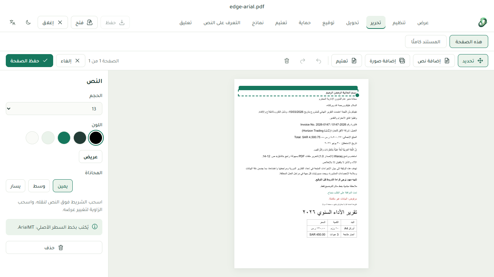
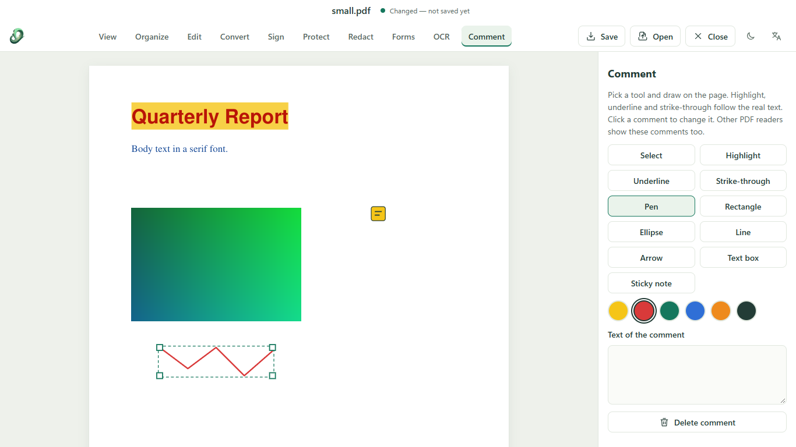
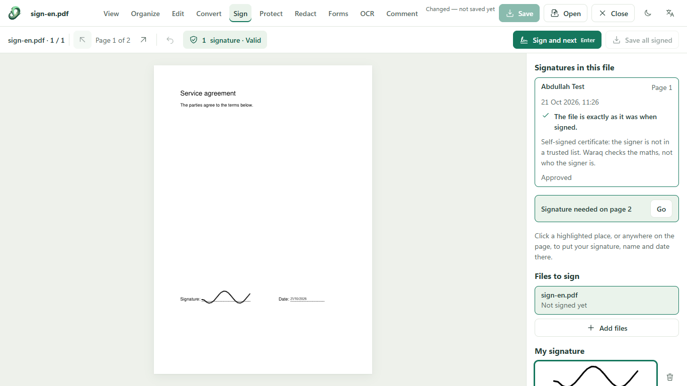
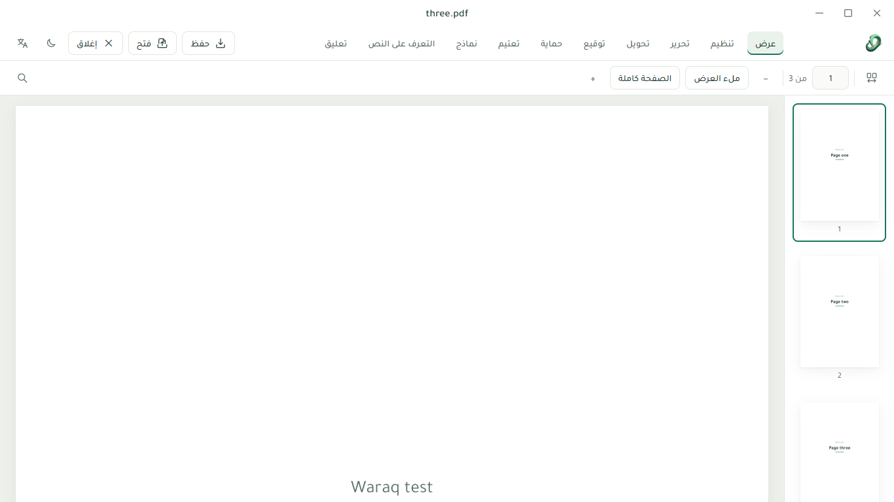
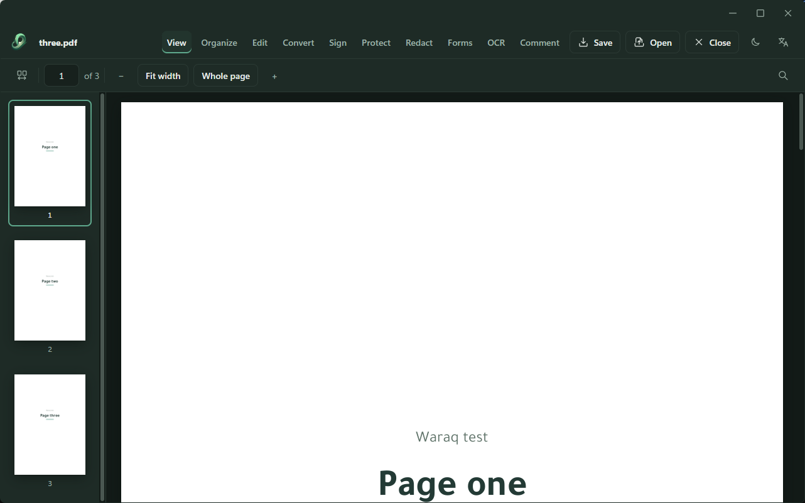
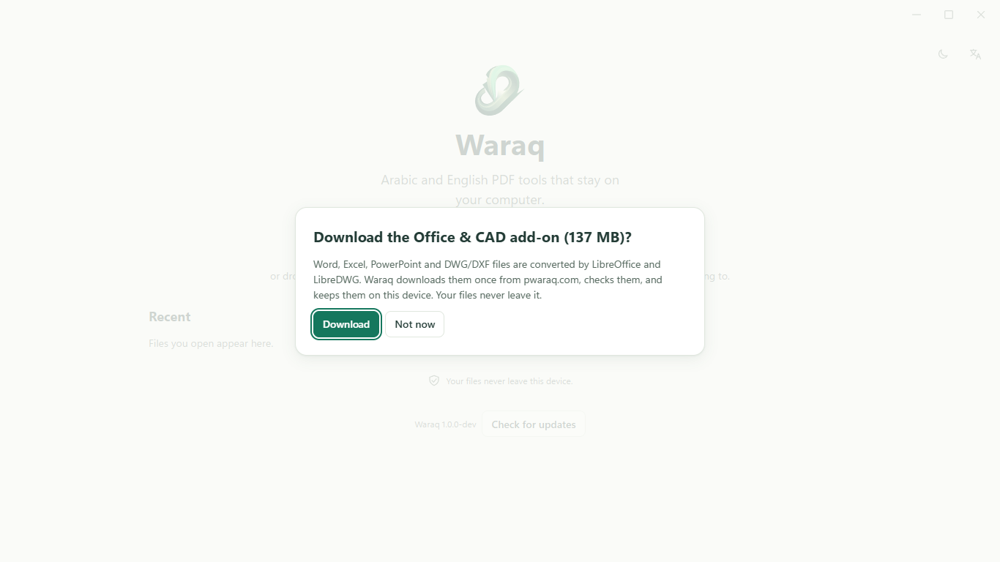

<p align="center"></p>

<h1 align="center">Waraq · ورق</h1>

<p align="center"><b>Arabic and English PDF tools that stay on your computer.</b><br>
أدوات PDF بالعربية والإنجليزية تبقى على جهازك.</p>

<p align="center">
  <a href="https://www.pwaraq.com">Website</a> ·
  <a href="https://www.pwaraq.com/download.html">Download for Windows</a> ·
  <a href="https://www.pwaraq.com/support">Support</a> ·
  <a href="next/release/RELEASE-NOTES-1.0-beta.md">1.0 beta release notes</a> ·
  <a href="#licence">Licence: AGPL-3.0-or-later</a>
</p>

---

## Waraq 1.0 beta

Waraq is a PDF studio that treats **Arabic as the first language, not an afterthought**. The interface is right to left
when you want it, Arabic you add is written as real, joined, searchable text, and when you change a line of an Arabic PDF
Waraq tries to keep the document's own font.

**Your files stay on your computer.** Waraq opens, edits, signs and converts PDFs on your own device; nothing is uploaded
unless you explicitly connect a processing engine of your own. It is free software
([AGPL-3.0-or-later](#licence)), made by one person who reads every report.

Waraq 1.0 is a ground-up rebuild (Svelte 5 + TypeScript, one PDF engine — our own MuPDF WebAssembly build — for the
website and the Windows app) and it is in **beta**: ready for everyday work, with limits that are written down
honestly in the [release notes](next/release/RELEASE-NOTES-1.0-beta.md#known-limits-in-this-beta). Waraq 0.3 (the
website you may know and the Electron Windows app) stays in [`app/`](app).

| | |
|---|---|
|  |  |
| **Edit** — click a line of an Arabic PDF and change it. The new line is written in the line's own font when the PDF allows it, and the panel says which font it used. | **Comment** — highlight, underline, strike through, draw, arrows, text boxes and notes, saved as standard PDF comments that Acrobat shows too. |
|  |  |
| **Sign** — draw, type or photograph a signature, or sign with a digital ID (certificate) and check other signatures. Waraq says plainly that it checks the maths, not who the signer is. | **Windows app** — the same Waraq in a small per-user installer, fully right to left in Arabic. |
|  |  |
| **Four themes**, chosen by hand: Light, Dim, Dark and Graphite. | **Word, Excel, PowerPoint, DWG and DXF** convert to PDF through a one-time add-on (137 MB). Waraq asks first, checks what it downloads and keeps it on your computer. |

### What it does
Ten tasks sit in one bar: **View · Organize · Edit · Convert · Sign · Protect · Redact · Forms · OCR · Comment**, plus
**Portfolio (حافظة)** for gathering a course's or a case's files into one PDF.

- **View and Organize:** crisp pages at exactly your screen's resolution (CAD sheets stay solid), thumbnails, find; a page
  grid to reorder, turn, delete, insert, extract, split and crop.
- **Edit:** change a line of text or a photo in place, add text and photos, page numbers and watermarks for the whole
  document; changes are real text, never a picture laid over the old words.
- **Convert and Protect:** Word/Excel/PowerPoint/DWG/DXF to PDF (desktop app), pages as images, compress; AES-256
  passwords and unlocking a file you have the password for.
- **Sign:** drawn, typed or photographed signatures with Gregorian or Hijri dates, many files in one go, and
  certificate (digital-ID) signatures you can create or import and verify.
- **Redact and Forms:** remove text, photos and lines for good; fill Arabic or English forms and keep them fillable.
- **OCR:** scanned pages get invisible text exactly over each printed word, so Find and copy work (see the numbers below).
- **Comment:** standard PDF annotations in Arabic and English.
- **Portfolio:** cover page, divider pages, contents with links, page numbers, bookmarks; saved as a portable `.waraq` file.
- **Looks after your work:** the document name sits on its own title bar with a dot when changes are unsaved; unsaved work
  is kept and offered back after a crash; saving checks the new file before it replaces the old one; a damaged PDF opens
  as far as it can be read; a crash report is shown to you first and only sent if you click.
- **Windows app:** about 28 MB, per-user (no administrator rights), "Open with Waraq" without taking over your default
  reader, checks for updates itself and goes back to the previous version if a new one does not start.

### Arabic, measured
We would rather give you numbers than adjectives. Everything below comes from scripted tests that live in this repository
(`next/tests`, `next/tools`), run on Arabic documents made with Edge, Word, LibreOffice and others, plus real public
documents and scans — never customers' files.

| | Result |
|---|---|
| Text Waraq writes (added text, covers, forms, comments, numbers, watermarks) | Shaped with HarfBuzz: joined letters, harakat, Persian and Urdu letters, Arabic-Indic digits, mixed Arabic/English lines; real text that copies and searches. |
| Changing an existing Arabic line | 2,584 scripted edits on 76 test PDFs: **89 %** pass with nothing to note, **98.9 %** have no real problem, **29 (1.1 %)** are known limits — fully vowelled lines from some producers, damaged source text, tiny Type 3 print, long mixed Arabic/English lines. They are listed in [`next/tests/audit-arabic/REMAINING-2026-10-22.md`](next/tests/audit-arabic/REMAINING-2026-10-22.md). |
| OCR, clean printed Arabic (office prints) | about **97 %** of words right (86–98 % across our clean test pages), measured with Tesseract. |
| OCR, genuinely scanned books | about **63 %** of words right with Tesseract — old prints, photocopies, fully vowelled text and number columns need checking by eye. |

The font Waraq uses for new Arabic text is [Tajawal](https://github.com/googlefonts/tajawal) (with Amiri and Noto as
fall-backs), all under the SIL Open Font Licence; see [THIRD-PARTY.md](THIRD-PARTY.md).

### Honest limits
Waraq 1.0 beta is not finished, and the [release notes](next/release/RELEASE-NOTES-1.0-beta.md#known-limits-in-this-beta)
say where. In short: some readers copy lines that mix Arabic and numbers in drawn order rather than reading order; Word,
Excel, PowerPoint and CAD conversion needs the desktop app and its add-on; the Windows installer is **not code-signed
yet**, so Windows SmartScreen shows "unknown publisher" the first time (More info → Run anyway).

## What is in this repository

| Folder | What it is | Status |
|---|---|---|
| [`app/`](app) | **Waraq 0.3** — the website at pwaraq.com and the Windows desktop app (Electron), with optional engines (MuPDF, qpdf, LibreOffice, LibreDWG, Tesseract) delivered as add-on packs. | Released (0.3.3) |
| [`next/`](next) | **Waraq 1.0 beta** — the rebuild: Svelte 5 + TypeScript, our own MuPDF WebAssembly engine in a pool of background workers, and a [Tauri](https://tauri.app) desktop shell with installer, updater and add-on packs. | Beta |

## Getting started

**Use it:** open [pwaraq.com](https://www.pwaraq.com) or download the Windows app from the website.

**Waraq 1.0 (development):** Node.js 22 or newer and pnpm (`corepack enable` gives you pnpm).
```bash
cd next
pnpm install
pnpm dev            # http://localhost:5188
pnpm check          # type and Svelte checks, must stay at 0 errors / 0 warnings
pnpm test:unit      # engine self-checks (Node)
pnpm test:e2e       # end-to-end journeys (Microsoft Edge)
pnpm stress:quick   # the low-token stress pipeline, a few seconds
```
The MuPDF WebAssembly engine is committed in `next/engine/mupdf-wasm/dist`; rebuilding it is described in
[`next/engine/README.md`](next/engine/README.md). The desktop shell needs Rust (stable, MSVC) — see
[CONTRIBUTING.md](CONTRIBUTING.md).

**Waraq 0.3 (current release):** see [`app/README.md`](app/README.md) — `node server.cjs` serves the website locally;
the desktop build steps are in [`app/desktop/README.md`](app/desktop/README.md).

## Privacy
Browser tools work on your device. Documents are kept in memory (and, for portfolios and recovered drafts, in your
browser's or the app's private storage) and are never sent anywhere by Waraq. Optional processing engines run locally
or on a server you choose. The only things the desktop app fetches are updates and the Office & CAD add-on, both checked
before use.

## Help, contributing and security
- **Questions and problems:** the [Support page](https://www.pwaraq.com/support), or write to
  [support@pwaraq.com](mailto:support@pwaraq.com). Please describe the document and the steps that show the problem —
  never attach confidential files.
- **Contributing:** see [CONTRIBUTING.md](CONTRIBUTING.md) (build, tests, Arabic test files, commit style).
- **Security reports:** [SECURITY.md](SECURITY.md) — privately, please.
- **What changed:** [CHANGELOG.md](CHANGELOG.md).

## Licence
Waraq is free software: you can redistribute it and/or modify it under the terms of the
**GNU Affero General Public License, version 3 or (at your option) any later version** — see [LICENSE](LICENSE).
Waraq ships MuPDF (AGPL) and, in the desktop add-on pack, LibreDWG (GPL). Third-party components and their licences
are listed in [THIRD-PARTY.md](THIRD-PARTY.md).

© Abdullah Designs
