<p align="center"></p>

<h1 align="center">Waraq · ورق</h1>

<p align="center"><b>Arabic and English PDF tools that stay on your computer.</b><br>
أدوات PDF بالعربية والإنجليزية تبقى على جهازك.</p>

<p align="center">
  <a href="https://www.pwaraq.com">Website</a> ·
  <a href="https://www.pwaraq.com/download.html">Download for Windows</a> ·
  <a href="#licence">Licence: AGPL-3.0-or-later</a>
</p>

---

Waraq is a PDF studio built for Arabic (right to left) and English. Open, read, organize, convert and sign PDFs in
the browser or in the Windows app. **Your documents are processed on your own device** — nothing is uploaded unless
you explicitly connect a processing engine of your own.

| | |
|---|---|
| 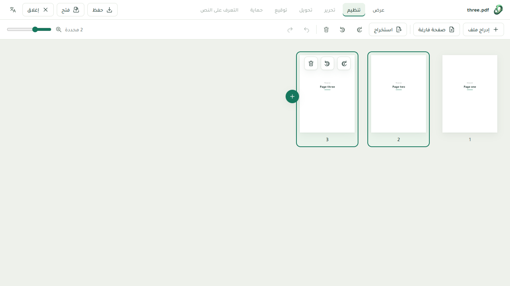 | 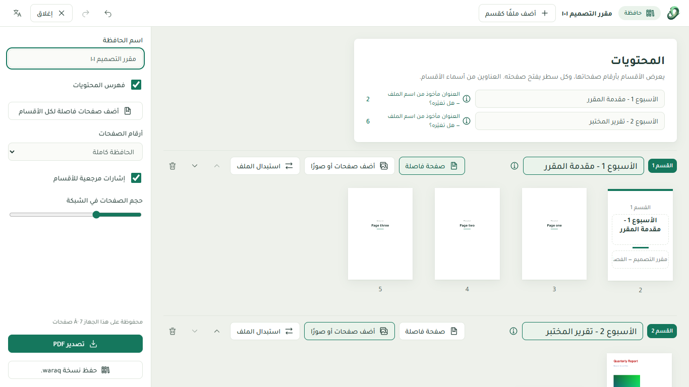 |
| **Organize** — every page in one grid: select, drag, turn, delete, insert files, photos or blank pages, extract. | **Portfolio** — gather a course's weekly files into one PDF you can keep adding to. |
| 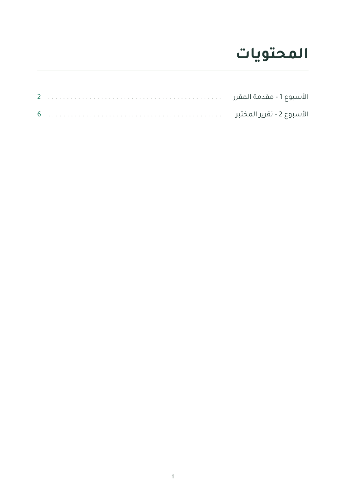 | 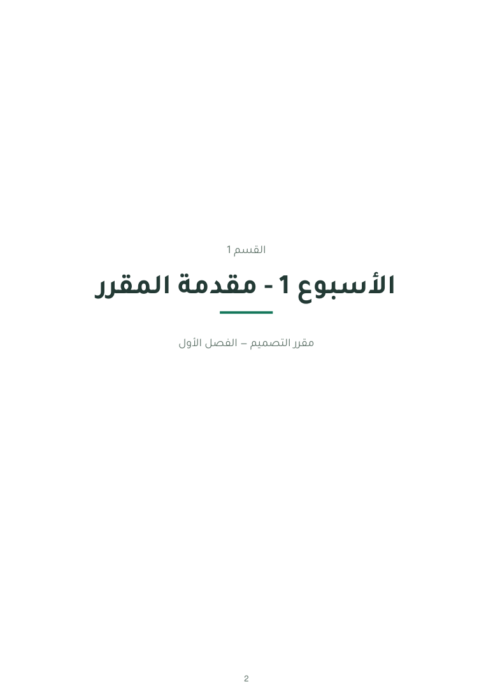 |
| Table of contents written by Waraq: real, searchable Arabic text; every line opens its page. | Section divider pages you write on directly. |

### Waraq 1.0 in use
| | |
|---|---|
| 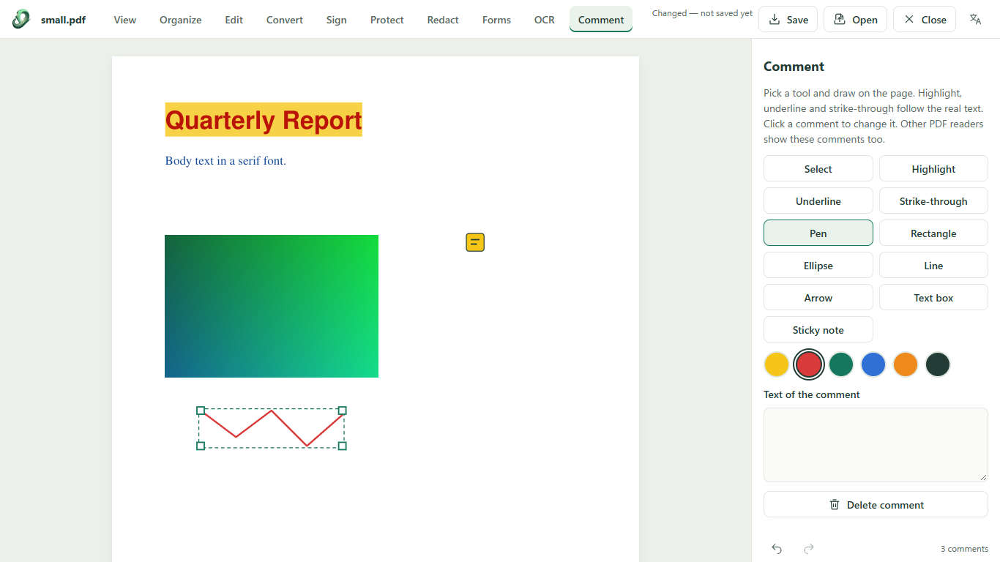 | 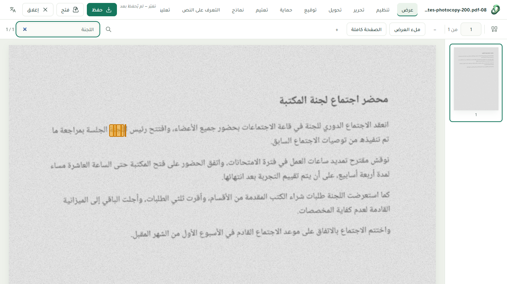 |
| **Comment** — highlight, underline, strike-through, pen, shapes, arrows, text boxes and notes, saved as standard PDF comments that Acrobat shows too. | **OCR** — scanned Arabic and English pages get invisible text exactly over each printed word, so search and copy work. |
| 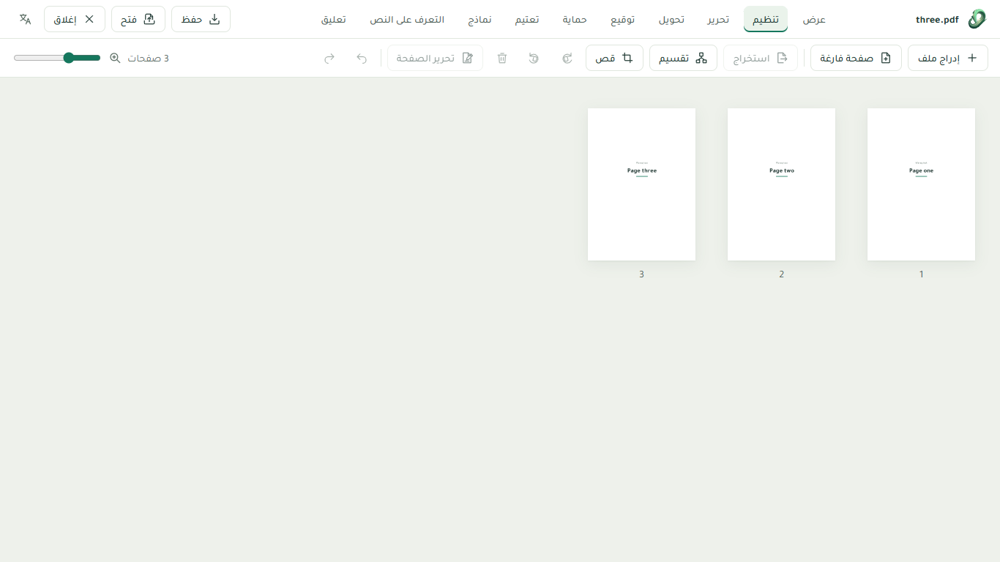 | 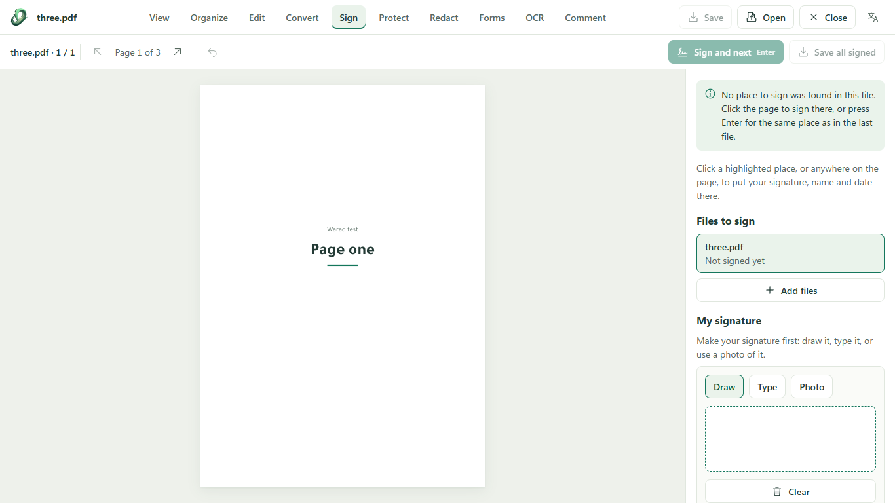 |
| Full right-to-left layout in Arabic. | **Sign** — draw, type or photograph a signature, place it with the date, sign many files in one go. |
| 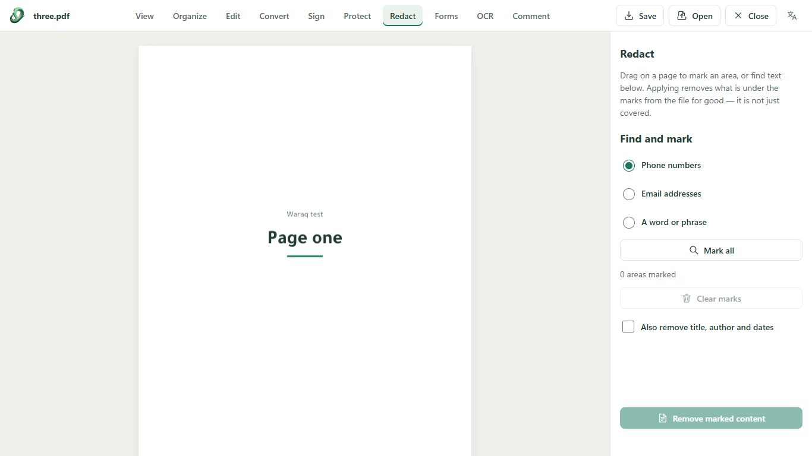 | 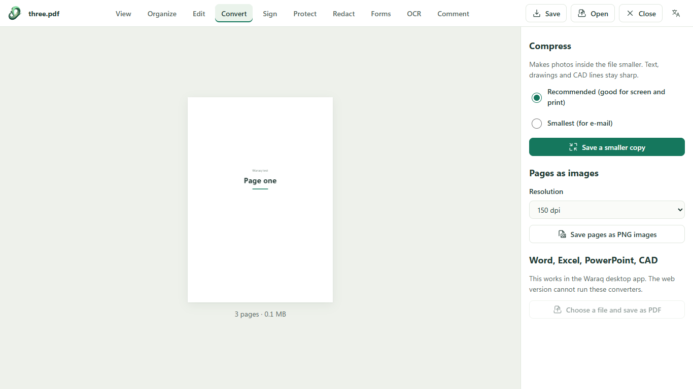 |
| **Redact** — remove text, photos and lines for good, not just paint over them. | **Convert** — compress, pages as images, and Word/Excel/PowerPoint/CAD to PDF in the desktop app. |

Four themes, chosen by hand: Light, and three darks (calm green Dim, deeper Dark, and neutral Graphite).

| | | |
|---|---|---|
| 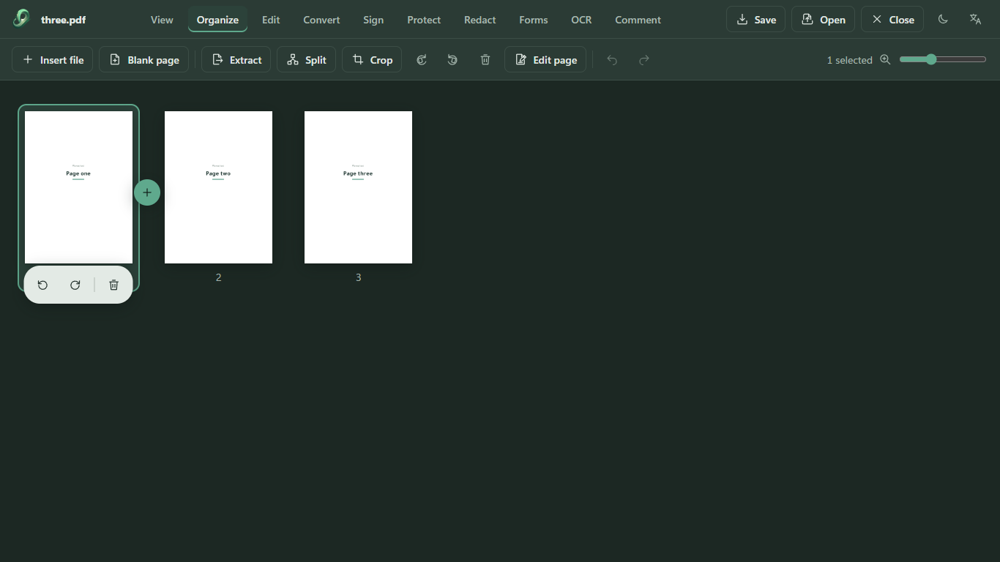 | 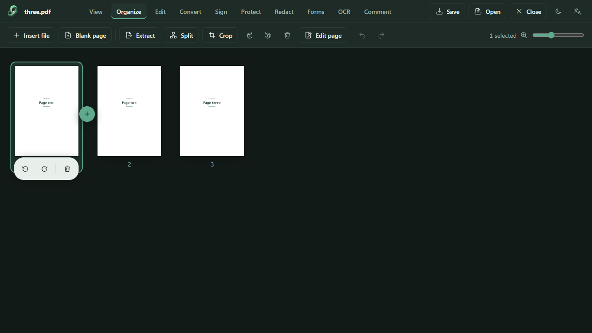 | 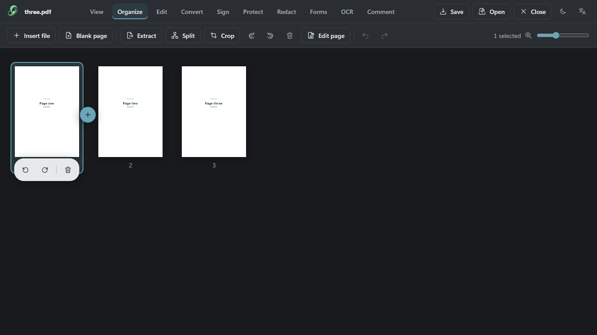 |
| Dim | Dark | Graphite |

## What is in this repository

| Folder | What it is | Status |
|---|---|---|
| [`app/`](app) | **Waraq 0.3** — the current release: the website at pwaraq.com and the Windows desktop app (Electron), with optional engines (MuPDF, qpdf, LibreOffice, LibreDWG, Tesseract) delivered as add-on packs. | Released (0.3.3) |
| [`next/`](next) | **Waraq 1.0** — the rebuild: Svelte 5 + TypeScript, one engine everywhere (our own MuPDF WebAssembly build), exact-resolution drawing for CAD sheets, Organize page grid, Portfolio. | In development |

### Highlights of Waraq 1.0 (`next/`)
- **One engine:** MuPDF compiled to WebAssembly (with a minimum line width so CAD hairlines stay solid), running in a
  pool of background workers; heavy A0 drawings stay responsive.
- **Crisp pages:** page images at exactly the screen's resolution, deep-zoom tiles when zoomed in.
- **Organize like a desktop editor:** full-window grid, multi-select, drag several pages, insert between pages, undo.
- **Page editor (first version):** add text and photos to a page, move, resize or replace photos, replace a line of
  text — opened from Organize, Portfolio or the Edit task.
- **Signing mode:** saved signatures, signature + date in one click, finds where to sign, many files in a row.
- **Everyday tools:** split, crop, page numbers, watermark, compress, pages as images, password protect and unlock.
- **Portfolio (حافظة):** sections made from files, titles taken from file names, a cover page (logos, title, names,
  supervisor, optional photo), 8 designs for cover and section pages in any colour, lined/grid/dotted pages, a table
  of contents with page numbers and links, sections you can drag, hide or lock, bookmarks, and a portable `.waraq` file.
- **Arabic first:** right-to-left interface, Arabic written as real joined text (Tajawal), copy and search work.
- **Tested:** engine self-checks, end-to-end journeys in Microsoft Edge, and a design-rule audit in both languages.

## Getting started

**Use it:** open [pwaraq.com](https://www.pwaraq.com) or download the Windows app from the website.

**Waraq 1.0 (development):** Node.js 22+ and pnpm.
```bash
cd next
pnpm install
pnpm dev            # http://localhost:5188
pnpm test:unit      # engine self-checks
pnpm test:e2e       # end-to-end journeys (Microsoft Edge)
```
The MuPDF WebAssembly engine is committed in `next/engine/mupdf-wasm/dist`; rebuilding it is described in
[`next/engine/README.md`](next/engine/README.md).

**Waraq 0.3 (current release):** see [`app/README.md`](app/README.md) — `node server.cjs` serves the website locally;
the desktop build steps are in [`app/desktop/README.md`](app/desktop/README.md).

## Privacy
Browser tools work on your device. Documents are kept in memory (and, for portfolios, in your browser's private
storage) and are never sent anywhere by Waraq. Optional processing engines run locally or on a server you choose.

## Contributing and security
Issues and pull requests are welcome — please describe the document and the steps that show the problem (never
attach confidential files). For security reports see [SECURITY.md](SECURITY.md).

## Licence
Waraq is free software: you can redistribute it and/or modify it under the terms of the
**GNU Affero General Public License, version 3 or (at your option) any later version** — see [LICENSE](LICENSE).
Waraq ships MuPDF (AGPL) and, in the desktop add-on pack, LibreDWG (GPL). Third-party components and their licences
are listed in [THIRD-PARTY.md](THIRD-PARTY.md).

© Abdullah Designs
